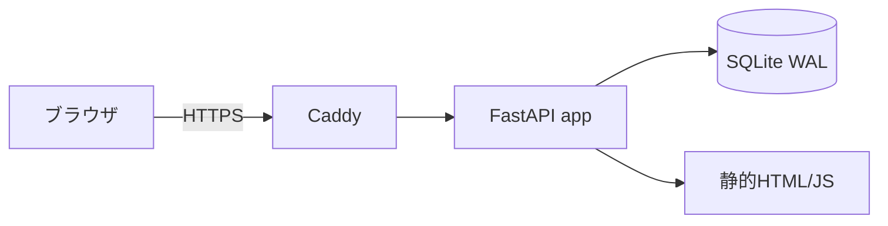

# 匿名プロフィールオファープラットフォーム backend-mvp-public

個人が氏名や連絡先を出さずに匿名プロフィール（価値観・悩み・希望）を公開し、興味を持った相手から必要な段階でオファーを受けられる場の設計・実装リポジトリ。
ただし、バックエンドのMVPです。

## このリポジトリの位置づけ

コード実装と設計の公開用スナップショットです。
As-Isであり、成果物評価版です。

## 公開版について

本リポジトリは公開用に再構成したスナップショットです。内部の計画文書（`plan/`）・作業ログ・一部の開発用設定・一部の内部向けテストは含まれていません。また、git の開発履歴は公開時に作り直しています。

設計・運用手順の一部は `DESIGN.md` と `docs/` に含まれます。各文書中の `plan/...` は、公開版に含まれない内部計画文書への参照です。運用系ドキュメントのホスト名・ディレクトリ・ユーザー名などは、公開版ではプレースホルダで示しています。

## 利用条件・免責

このリポジトリは公開アーカイブです。コードは自由にコピー・利用できますが、以下を了承してください。

- 動作・安全性・特定目的への適合性は保証しません。
- 本リポジトリを利用した結果について、作者は責任を負いません。自己責任で利用してください。
- Issue / Pull Request は原則として受け付けません。
- 脆弱性の報告は [SECURITY.md](SECURITY.md) の手順に従ってください。

## 設計・ドキュメント

- [DESIGN.md](DESIGN.md): 統合設計書
- [design/](design/): 分割設計書
- [docs/deployment.md](docs/deployment.md): デプロイ運用
- [docs/operations.md](docs/operations.md): 運用手順
- [docs/logging.md](docs/logging.md): ログ運用

## 構成



## コントリビューション

本リポジトリは公開用スナップショットです。原則として外部からの Issue / Pull Request は受け付けません。

## セキュリティ

脆弱性の報告は、公開 Issue ではなく [SECURITY.md](SECURITY.md) の手順（GitHub の Private vulnerability reporting）を利用してください。

## ライセンス

MIT License。詳細は [LICENSE](LICENSE) を参照してください。

## 環境構築の解説
※詳細に触れません

このプロジェクトのルートで
```shell
docker version
docker compose version
make --version
```
が問題なくできれば動作確認できるはずです。

## 最小限の動作確認


### 1.準備
.env.exampleをコピーして.envを作成


### 2. .envの編集

```shell
# APP PEPPERの作成
docker run --rm python:3.14-slim python -c "import secrets; print(secrets.token_urlsafe(32))"
```


```.env
# .envファイル内
APP_PEPPER=<生成したAPP PEPPERを張り付け>
```

### 3. 立ち上げ
```shell
make build
make migrate
make up
```

### 4. 確認

ブラウザで
https://localhost:8443/new を開く

1. 「プロフィール作成」をクリック
2. 「全体保存」をクリックしてメモ帳等に貼り付け
3. 「保存した」にチェックをつけて、「続ける」をクリック
4. プロフィールを編集(公開するをクリックして、保存すると、ログイン無しでhttps://localhost:8443/profiles/<public_id> で参照できるが、public_idは、現時点では、DBにのみ存在[profilesテーブル内])

例えば、

1. https://localhost:8443/new で1個目のプロフィール作成と公開、アカウント情報メモ
2. https://localhost:8443/new で2個目のプロフィール作成と公開
3. https://localhost:8443/login で1個目のアカウント情報入力
4. https://localhost:8443/profile-editor で、1個目のプロフィール情報を取得できる

### 5. 終了
```shell
make down #DBも消す場合は、`make reset-data`を実行 
```

